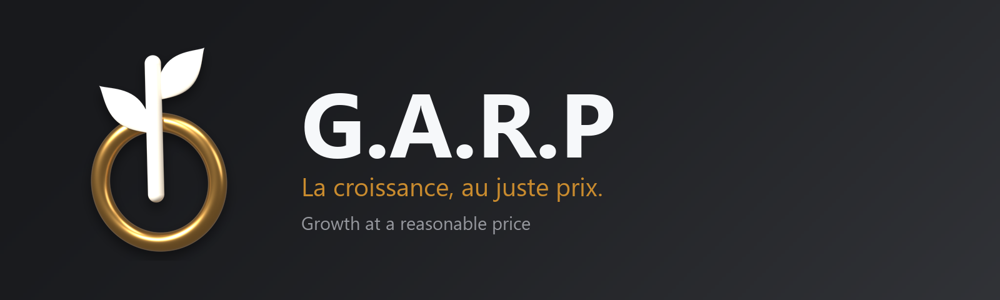

# Marque G.A.R.P

Le projet s'appelle **G.A.R.P** depuis le 18/11/2026. Il s'appelait auparavant Climax. Depuis le 22/11/2026, le dépôt public (`spuiksterr/GARP`), les fichiers publiés (`GARP-Setup`, `garp-outil.zip`), le lanceur (`GARP.pyw`) et les icônes (`garp.png`, `garp.ico`) portent aussi le nouveau nom. Gardent l'ancien, invisible à l'usage : le dossier de données `%LOCALAPPDATA%\Climax` (portefeuille et données déjà installés) et le dépôt privé d'origine `spuiksterr/Climax`, archive de l'historique.

## Positionnement

**G.A.R.P** aide un particulier à construire et suivre un portefeuille d'actions pour le temps long, avec une méthode écrite plutôt qu'à l'intuition.

Le nom vient de *Growth at a reasonable price*, la croissance à un prix raisonnable : la méthode d'investissement popularisée par Peter Lynch, qui cherche des entreprises en croissance sans les payer n'importe quel prix. C'est exactement ce que fait l'outil : la qualité et la croissance d'un côté, la valorisation de l'autre.

- **Pour qui** : l'investisseur particulier francophone qui gère lui-même un PEA ou un compte-titres et veut comprendre ce qu'il possède.
- **Ce que G.A.R.P apporte** :
  - 1 760 actions passées au crible chaque nuit (qualité, croissance, valorisation) ;
  - le portefeuille surveillé (concentration, vigilance) ;
  - des thèses écrites et des règles de vente fixées à l'avance.
- **Ce que G.A.R.P n'est pas** : un conseiller, un signal d'achat, une application de trading. Chaque écran qui touche à une décision le rappelle.

**Promesse** : *La croissance, au juste prix.*

Autres accroches, pour les présentations :
- *Growth at a reasonable price.*
- *Investir sur le temps long, avec méthode.*
- *Choisir peu, garder longtemps.*

## Logo

Le logo montre **une pousse ivoire qui monte de l'intérieur d'une pièce, un anneau de métal ocre**. La tige part du cœur de la pièce. Ses deux feuilles en amande passent devant l'anneau : la gauche plus bas, la droite plus haut. La pièce, c'est le prix payé ; la pousse, la croissance qu'il achète. Les deux ensemble disent G.A.R.P : la croissance, au juste prix. L'image garde aussi l'esprit de Climax, ce qui pousse lentement sur le temps long. Le logo est modelé en 3D dans Blender, d'après l'esquisse retenue (mêmes proportions) : anneau de métal ocre, tige et feuilles ivoire, éclairage de studio.

Choisi le 19/11/2026 (piste « pousse et pièce ») parmi six pistes :
- zone GARP ;
- G fléché ;
- balance ;
- points qui montent ;
- pousse et pièce ;
- étiquette.

La piste « points qui montent » a servi un jour, le 18/11/2026. Le logo remplace l'emblème de Climax (courbe exponentielle ocre au-dessus de barres ivoire).

| Fichier | Usage |
|---|---|
| `assets/blender/embleme.png` | Emblème seul, fond transparent, 1024 px : la source de tout le reste |
| `assets/garp.png`, `assets/garp.ico` | Icône arrondie : fenêtre de l'outil, raccourcis Windows, onglet du navigateur |
| `assets/entete.png` | Icône et « G.A.R.P » en ocre : en-tête de la barre latérale, écran d'ouverture |
| `docs/bandeau.png` | Bandeau des README et des présentations |
| `installateur/*.bmp` | Images de l'assistant d'installation Windows (son icône : `assets/garp.ico`) |

Règles d'usage :
- **Fond** : l'emblème se pose sur le dégradé anthracite → graphite, ou sur une couleur unie sombre. Pas de fond blanc : la pousse ivoire disparaît.
- **Marge** : garder autour de l'emblème au moins un quart de sa largeur.
- **Taille** : en dessous de 24 px, préférer l'icône arrondie (`garp.ico` a ses propres tailles).
- **Interdits** : ne pas déformer, recolorer, faire pivoter ni ajouter d'effets ; ne pas séparer la pousse de sa pièce.

Pour refaire les images, depuis `portefeuille/` :
1. Le modèle 3D (facultatif, avec Blender 5.3) :
   ```
   blender -b --factory-startup --python assets/blender/logo.py -- <dossier> garp_pousse
   ```
   Le résultat remplace `assets/blender/embleme.png`.
2. Toutes les icônes et le bandeau :
   ```
   .venv/Scripts/python.exe assets/composer_icones.py icones assets/blender/embleme.png
   ```

`logo.py` garde aussi les pistes écartées : celles de G.A.R.P (`garp_*`) et celles de Climax (« pousse », « pic », « expo_ivoire_ocre »…). Pour les comparer sur le fond de la marque :
```
composer_icones.py planche <dossier des rendus> planche.png [palette]
```

## Couleurs

| Nom | Code | Rôle |
|---|---|---|
| Anthracite | `#18191C` | Début du dégradé, écran de démarrage, fonds sombres |
| Graphite | `#3A3C41` | Fin du dégradé |
| Ocre | `#C98B2E` | La pièce ; accroche du bandeau |
| Ocre foncé | `#8A5A12` | Accents sur fond clair (l'ocre seul manque de contraste sur blanc) |
| Ivoire | `#EDE6D8` | La pousse ; aplats clairs |
| Blanc | `#F6F8FA` | Texte sur les fonds sombres |

Dans l'outil (`.streamlit/config.toml`), l'accent est l'ocre de la marque, choisi pour son contraste. Il colore les boutons, curseurs, onglets actifs et liens : `#A86C1A` en thème sombre (liens `#C98B2E`), l'ocre foncé `#8A5A12` en thème clair. La courbe et les répartitions du portefeuille sont en ocre ; l'indice de comparaison est en gris ; les graphiques à plusieurs séries gardent la palette validée de `pf/ui.py`. Les grands chiffres du tableau de bord sont en `#B9781F`, lisible sur les deux fonds.

Verdicts de prix : « Au bon prix » en vert, « Prix correct » en ambre, « À attendre » et « Non évalué » en gris. Le mot est toujours écrit : la couleur ne porte jamais seule l'information.

Les couleurs d'état (vert pour une hausse, rouge pour une baisse ou une exclusion) ne reprennent pas l'ocre, pour qu'une alerte ne se confonde pas avec la marque.

## Typographie

- **Outil** : titres en Manrope (licence OFL, embarquée dans `static/polices/`, aucun téléchargement à l'usage), texte courant en Source Sans 3, la police de Streamlit.
- **En-tête de la barre latérale et écran d'ouverture** : `assets/entete.png` (icône et « G.A.R.P » en ocre), produite par `composer_icones.py`.
- **Bandeau et présentations** : Segoe UI Bold pour le nom, Segoe UI pour l'accroche.
- **Le nom** s'écrit toujours « G.A.R.P », avec ses points et sans point final : ni « GARP », ni « Garp », ni « G.A.R.P. ». Dans une phrase qui se termine par le nom, le point de la phrase suffit. L'expression anglaise s'écrit *Growth at a reasonable price*.

## Ton

- **Clair et posé** : phrases courtes, chiffres avec leur unité, pas de jargon sans explication.
- **Honnête** : dire ce qu'une mesure ne dit pas, et rappeler qu'un rang élevé n'est pas un conseil.
- **Pas d'urgence ni de promesse de gain** : ni « opportunité à saisir », ni « surperformez le marché ». G.A.R.P parle de méthode et de prix, pas de rendement.
- **Vouvoiement** dans l'outil, l'application et les textes publics.

## Textes de présentation

**Court** (80 caractères) :
> Screener d'actions et suivi de portefeuille : la croissance, au juste prix.

**Description** (page de téléchargement, README) :
> G.A.R.P passe chaque nuit 1 760 actions américaines et européennes au crible : qualité des comptes, croissance, valorisation, transactions des dirigeants. Il cherche la croissance sans la payer trop cher. Importez votre portefeuille depuis l'export de votre courtier : G.A.R.P reconnaît vos lignes et surveille la concentration, les secteurs, les devises et les points de vigilance. Vos positions restent sur votre appareil. G.A.R.P n'est pas un conseiller financier : il vous aide à appliquer votre propre méthode.

**Points clés** (captures d'écran, dans cet ordre) :
1. Tableau de bord : le portefeuille en un coup d'œil, les points de vigilance.
2. Import : un export de courtier reconnu ligne par ligne.
3. Screener : recherche, filtres, tris.
4. Fiche valeur : cours, indicateurs, prix juste.
5. Barre latérale : données de la nuit, nouvelle version.
